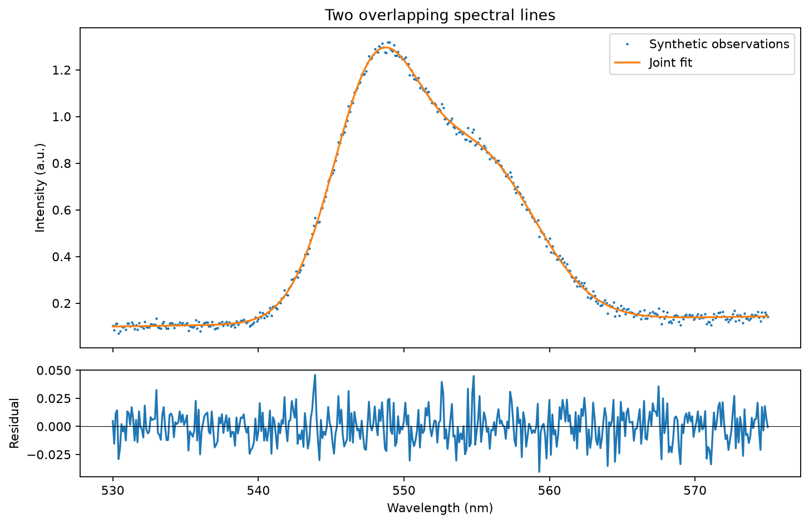

# Spectral peak fitting — OptiIA Consulting

Resolve two overlapping spectral lines with a joint Gaussian model and linear background.

Reproducible project example using synthetic data. No proprietary code or datasets are included.



## Run

Python 3.12 recommended. From this repository:
```bash
python -m pip install -r requirements.txt
python -m unittest -v test_analysis
python analysis.py --seed 42 --out results
```

The script regenerates the data, plots and metrics in `results/`. The root `preview.png` and `metrics.json` show the seed-42 example. Change `--seed` to inspect another realization. Import the functions in `analysis.py` for your own arrays; review their units and input requirements first.

## Method

Fit two positive Gaussian peaks plus an affine background using bounded nonlinear least squares. Export centres, widths, Gaussian areas and fit residuals. Centres are constrained to separate wavelength windows to avoid label switching.

## Assumptions and limits

Exactly two peaks and approximate centre windows are supplied. Gaussian line shapes, independent noise and a correct baseline model are assumed. No automatic peak-count selection or instrument calibration is provided. Strong overlap can make parameters unidentifiable.

Metrics describe this synthetic example only. Real measurements require representative data, calibrated inputs and independent validation.

## Validation

Four automated tests check analytical/noiseless references, independent inputs or noise realizations, and invalid inputs. See `test_analysis.py`.

## Applications

Scientific data analysis, numerical optics and Python automation for research workflows. This example is independent of the other projects in the [portfolio](https://github.com/yaghi-ali).

OptiIA Consulting · contact@optiia-consulting.fr · https://www.optiia-consulting.fr
